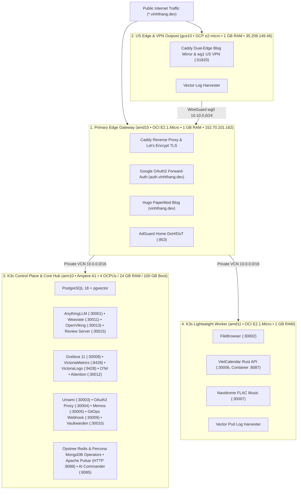

# Vinh Thang Cloud & AI Fleet (`vinhthang.dev`)

[](https://k3s.io)
[](https://helm.sh)
[](https://www.oracle.com/cloud/free/)
[](https://www.postgresql.org)
[](https://victoriametrics.com)
[](https://victoriametrics.com/products/victorialogs/)
[](https://grafana.com)
[](.github/workflows/deploy.yaml)

Automated, production-grade Infrastructure as Code (IaC), **Master Umbrella Helm Chart (`charts/vinhthang-fleet`)**, **multi-cloud K3s manifests**, **Zero-Trust Caddy ingress**, **GitOps automation**, and **offline architectural fitness gates (`pytest tests/`)** powering [**`vinhthang.dev`**](https://vinhthang.dev).

---

## Fleet Architecture Topology



---

## Hardware & Cost Invariants

| Node | Provider & Shape | Role | CPU / RAM / Storage | Network & Perimeter |
| :--- | :--- | :--- | :--- | :--- |
| **`arm10`** | OCI `VM.Standard.A1.Flex` | K3s Control Plane, DBs, AI & Observability | **4 OCPUs / 24 GB RAM / 100 GB** (PAYG `$0/mo` locked via `always-free-payg-guardrail`) | Private Subnet (`10.0.1.0/24`), SSH via `amd10` `ProxyJump` |
| **`amd10`** | OCI `VM.Standard.E2.1.Micro` | Primary Edge Gateway, Caddy, AdGuard, WireGuard Hub | **1 OCPU / 1 GB RAM / 47 GB** | Public Reserved IP (`152.70.101.162`) |
| **`amd11`** | OCI `VM.Standard.E2.1.Micro` | Lightweight AMD64 Worker (`FileBrowser`, `VietCalendar`, `Navidrome`) | **1 OCPU / 1 GB RAM / 47 GB** | Private Subnet (`10.0.1.0/24`), SSH via `amd10` `ProxyJump` |
| **`gce10`** | GCP `e2-micro` (`us-central1`) | US Dual-Edge Blog Mirror, K3s Worker & `wg1` US VPN | **2 vCPU (shared) / 1 GB RAM** | Public IP (`35.209.149.46`), `wg0` (`10.10.0.4/24`) |

---

## Master Production Services Directory

| Service | Official HTTPS URL | Access Control | NodePort / Port | Host Node |
| :--- | :--- | :--- | :--- | :--- |
| **AnythingLLM AI** | [`ai.vinhthang.dev`](https://ai.vinhthang.dev) | Google SSO (`sso_auth`) | `30001` | `arm10` |
| **FileBrowser Storage** | [`files.vinhthang.dev`](https://files.vinhthang.dev) | Google SSO (`sso_auth`) | `30002` | `amd11` |
| **Umami Analytics** | [`analytics.vinhthang.dev`](https://analytics.vinhthang.dev) | Google SSO dashboard + public telemetry | `30003` | `arm10` |
| **Central OAuth2 Proxy** | [`auth.vinhthang.dev`](https://auth.vinhthang.dev) | Google OAuth2 Forward-Auth portal | `30004` | `arm10` |
| **Memos AI Journal** | [`memos.vinhthang.dev`](https://memos.vinhthang.dev) | Google SSO (`sso_auth`) | `30005` | `arm10` |
| **VietCalendar API** | [`api.vinhthang.dev`](https://api.vinhthang.dev) | Public stateless Rust API | `30006` (`:8087`) | `amd11` |
| **Navidrome Lossless** | [`music.vinhthang.dev`](https://music.vinhthang.dev) | Subsonic API / native auth | `30007` | `amd11` |
| **Grafana 11 & Status** | [`grafana.vinhthang.dev`](https://grafana.vinhthang.dev) / [`status.vinhthang.dev`](https://status.vinhthang.dev) | Google SSO (`grafana`), read-only status (`403` on `/login*`, `/admin*`, `/explore*`) | `30008` | `arm10` |
| **GitOps Webhook** | [`webhook.vinhthang.dev`](https://webhook.vinhthang.dev) | HMAC SHA-256 verified | `30009` (`:9000`) | `arm10` |
| **Vaultwarden** | [`vault.vinhthang.dev`](https://vault.vinhthang.dev) | Zero-knowledge native auth (`SIGNUPS_ALLOWED=false`) | `30010` | `arm10` |
| **Weaviate Vector DB** | [`weaviate.vinhthang.dev`](https://weaviate.vinhthang.dev) | Native API key auth | `30011` | `arm10` |
| **Attention Metrics** | [`attention.vinhthang.dev`](https://attention.vinhthang.dev) | Google SSO dashboard + public ingestion | `30012` (`:8086`) | `arm10` |
| **OpenViking Context DB** | [`openviking.vinhthang.dev`](https://openviking.vinhthang.dev) | Native token auth + MCP | `30013` | `arm10` |
| **AI Review Server** | [`review.vinhthang.dev`](https://review.vinhthang.dev) | Google SSO UI + Bearer API + HMAC webhooks | `30015` (`:8765`) | `arm10` |
| **Hugo Tech Blog** | [`vinhthang.dev`](https://vinhthang.dev) | Public dual-edge static CDN | Caddy file server | `amd10` / `gce10` |
| **AdGuard Home** | [`adguard.vinhthang.dev`](https://adguard.vinhthang.dev) | Google SSO dashboard + DoH/DoT (`:853`) | `127.0.0.1:3000` | `amd10` |
| **Web Reader** | [`reader.vinhthang.dev`](https://reader.vinhthang.dev) | Public edge proxy over WireGuard | `10.10.0.4:3000` | Standalone |
| **Internal Datastores & Ops** | CoreDNS (`data`, `observability`, `operators`, `system`) | Cluster-internal only | PG `:5432`, VM `:8428`, VL `:9428`, Pulsar `:8088`, Commander `:8085` | `arm10` |

---

## Master Helm Chart & Retained Secret Hygiene (`ADR-0052`)

All cluster workloads are packaged in the Master Umbrella Helm Chart under domain-partitioned subdirectories:

```text
charts/vinhthang-fleet/
├── Chart.yaml
├── values.yaml                  # Non-secret defaults & pinned container image tags
├── values.secrets.example.yaml  # Safe CI/template placeholder values (zero real secrets)
└── templates/
    ├── namespaces.yaml          # Kept across upgrades (helm.sh/resource-policy: keep)
    ├── ai/                      # anythingllm, anythingllm-indexer-cron, openviking, weaviate
    ├── apps/                    # filebrowser, memos, navidrome, review-server, umami, vaultwarden, vietcalendar
    ├── data/                    # postgres, mongodb, redis*, pulsar-pvs, qa-fed-shared-datastores
    ├── observability/           # attention-metrics-server, grafana, grafana-alert-rules, otel-collector, vector, victoria*
    ├── operators/               # psmdb-operator, redis-operator
    └── system/                  # ai-incident-commander, daily-briefing-cronjob, gitops-webhook, nightly-backup-cronjob, oauth2-proxy
```

* **Zero Default Secrets (`ADR-0052`)**: `helm template charts/vinhthang-fleet` produces `0` `Secret` objects by default (`createSecret: false`), preventing `gitops-webhook` upgrades from overwriting live Secrets or storing credentials in Git.
* **Retained Secret Contract**: Bootstrap Secrets once with `helm.sh/resource-policy: keep` (or pass `-f values.secrets.example.yaml` for offline CI validation), then run clean GitOps upgrades (`helm upgrade --install fleet ./charts/vinhthang-fleet`).

---

## Deployment, Edge Sync & CI Fitness Gates

### 1. In-Cluster Kubernetes GitOps vs. Manual Edge Sync
* **Kubernetes Fleet**: Pushing to `main` triggers `https://webhook.vinhthang.dev/webhook` (HMAC SHA-256 verified), which pulls the repository and runs `helm upgrade --install fleet ./charts/vinhthang-fleet` on `arm10`.
* **Edge Caddyfile & Hugo Blog (Manual Sync)**: Synchronizing [`caddy/Caddyfile`](caddy/Caddyfile) and rebuilding the Hugo static site on both `amd10` and `gce10` is an explicit manual step via [`scripts/gitops-sync.sh`](scripts/gitops-sync.sh), which loads the validated Caddyfile directly through Caddy's local Admin API (`http://127.0.0.1:2019/load`) on both edge hosts.

### 2. Automated CI & Offline Architectural Fitness Suite (`pytest tests/`)
Every push to `main` runs [`.github/workflows/deploy.yaml`](.github/workflows/deploy.yaml):
1. `helm lint` and `helm template` across `vinhthang-fleet`, `bec-datastores`, `qa-router-datastores`, and `vedge-api-local`.
2. `terraform fmt -check -recursive` across root OCI Terraform and `infra/gcp/`.
3. `PYTHONDONTWRITEBYTECODE=1 pytest -v tests/` enforcing:
   * [`tests/test_caddy_security.py`](tests/test_caddy_security.py): `(strip_auth_headers)`, `(sso_auth)`, `status.vinhthang.dev` path blocks, AdGuard SSO, FileBrowser `10.0.0.216:30002`, zero `tls internal`.
   * [`tests/test_helm_policies.py`](tests/test_helm_policies.py): Zero `:latest`/untagged images, zero default Secrets or plaintext credential leaks, port governance (`vietcalendar` `:8087`, Pulsar `:8088`, zero custom `:8080`), least-privilege RBAC, and domain-organized `templates/`.
   * [`tests/test_terraform_and_scripts.py`](tests/test_terraform_and_scripts.py): `prevent_destroy` & `preserve_boot_volume` in `compute.tf` and `infra/gcp/`, shell syntax & `127.0.0.1:2019/load` checks, and `scripts/agy_proxy.py` `127.0.0.1` + async safety.
   * [`tests/test_docs_and_specs_governance.py`](tests/test_docs_and_specs_governance.py): Sequential ADR numbering (`0001`–`0053`), Status/Date headers, spec Gate 1/Gate 2 hygiene, and rule/README alignment.

---

## Repository Directory

```text
├── .agents/rules/           # Always-on governance rules (adr-governance.md)
├── .github/workflows/       # GitHub Actions Helm, Terraform & pytest CI gate (deploy.yaml)
├── blog/                    # Hugo static tech blog Markdown content & partials
├── caddy/                   # Declarative edge gateway Caddyfile (synced via scripts/gitops-sync.sh)
├── charts/                  # Helm charts (vinhthang-fleet, bec-datastores, qa-router-datastores, vedge-api-local)
├── docs/
│   ├── README.md            # Master ADR registry & system invariants
│   ├── adr/                 # Architecture Decision Records (0001–0053)
│   └── specs/               # 5-Document specification packages + INDEX.md
├── infra/gcp/               # GCP Always Free Terraform configuration (gce10)
├── scripts/                 # gitops-sync.sh, agy_proxy.py, trigger-gemini-indexer.sh, helpers
├── tests/                   # Offline pytest architectural fitness suite
├── wireguard/               # WireGuard topology notes (keys excluded via .gitignore)
├── compute.tf               # OCI instances (amd10, amd11, arm10) & PAYG quota guardrail
├── network.tf               # OCI VCN, public/private subnets, NAT/IGW & security lists
├── outputs.tf               # Terraform outputs & SSH ProxyJump helpers
├── provider.tf              # OCI Terraform provider configuration
└── variables.tf             # Terraform input variables
```

---

## Quickstart & Terraform Provisioning

```bash
cp terraform.tfvars.example terraform.tfvars
# Populate Tenancy OCID and SSH Public Key (~/.ssh/id_ed25519.pub)
terraform init && terraform plan
PYTHONDONTWRITEBYTECODE=1 pytest -v tests/
```

Maintained by [Thang Hoang](https://vinhthang.dev). Architecture decisions are indexed in [`docs/README.md`](docs/README.md).
