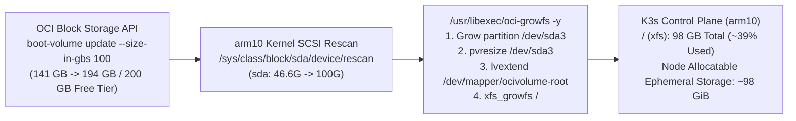

# Technical Design: Online `arm10` Boot Volume Expansion to 100 GB

**Feature ID**: `arm10-boot-volume-expansion`  
**Status**: Planning  

---

## 1. Storage Expansion Architecture (`REQ-001`, `REQ-002`)



---

## 2. OCI Boot Volume Resize & Live OS Grow Sequence (`REQ-001`, `REQ-002`)

### 2.1 OCI Control Plane Resize (`REQ-001`)
Target Boot Volume OCID:
`ocid1.bootvolume.oc1.ap-tokyo-1.abxhiljrhktr73l7neuytuukt2a2yyvbher7soj3ndrkylx2y4uj6ugavtca`

```bash
rtk oci bv boot-volume update \
  --boot-volume-id ocid1.bootvolume.oc1.ap-tokyo-1.abxhiljrhktr73l7neuytuukt2a2yyvbher7soj3ndrkylx2y4uj6ugavtca \
  --size-in-gbs 100 \
  --wait-for-state AVAILABLE
```

### 2.2 Online Kernel Rescan & LVM/XFS Growth (`REQ-002`)
Executed on `arm10` via SSH (`ProxyJump` through `amd10`):
```bash
# 1. Rescan paravirtualized block device /dev/sda
rtk ssh arm10 "echo 1 | sudo tee /sys/class/block/sda/device/rescan"

# 2. Expand partition 3, LVM PV/LV (ocivolume-root), and XFS filesystem live
rtk ssh arm10 "sudo /usr/libexec/oci-growfs -y"

# 3. Verify block layout and filesystem capacity
rtk ssh arm10 "lsblk && df -Th /"
```

---

## 3. Declarative Terraform Synchronization (`REQ-003`)

In [`compute.tf`](file:///Users/thanghoang/github/oci/compute.tf#L117-L145), update `oci_core_instance.arm10` `source_details` to declare `boot_volume_size_in_gbs = 100`:

```hcl
  source_details {
    source_type             = "image"
    source_id               = data.oci_core_images.oracle_linux_10_arm.images[0].id
    boot_volume_size_in_gbs = 100
  }
```

Import the existing `arm10` compute instance into [`terraform.tfstate`](file:///Users/thanghoang/github/oci/terraform.tfstate) so Terraform tracks the live instance:
```bash
rtk terraform import oci_core_instance.arm10 ocid1.instance.oc1.ap-tokyo-1.anxhiljrnfuvvryc6oko53rm4ye7fjpo5xv7qybcbmm6p5pzjie66xtnqsna
```

---

## 4. K3s Ephemeral Storage & Containerd Space Hygiene (`REQ-004`)

Clean up completed job pods and unused containerd image layers on `arm10`:
```bash
rtk ssh arm10 "
  sudo /usr/local/bin/k3s kubectl delete pod -A --field-selector=status.phase==Succeeded
  sudo /usr/local/bin/k3s crictl rmi --prune
  sudo /usr/local/bin/k3s kubectl describe node arm10 | grep -E 'Capacity:|Allocatable:|ephemeral-storage:|DiskPressure' -A 2
"
```

---

## 5. Architecture Governance (`REQ-005`)
- Create [`docs/adr/0045-expand-arm10-boot-volume-storage.md`](file:///Users/thanghoang/github/oci/docs/adr/0045-expand-arm10-boot-volume-storage.md) documenting the OCI Always Free quota math (`47 + 47 + 100 = 194 GB <= 200 GB`), online LVM/XFS expansion procedure, and Terraform codification.
- Register `ADR-0045` in [`docs/README.md`](file:///Users/thanghoang/github/oci/docs/README.md).
