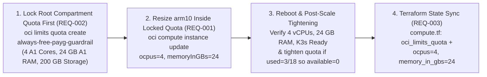

# Technical Design: Scale `arm10` to 4 OCPUs / 24 GB RAM & Lock Always-Free PAYG Quotas

**Feature ID**: `arm10-payg-scale-and-quota-lock`  
**Status**: Planning  

---

## 1. Architecture & Execution Flow (`REQ-002` -> `REQ-001` -> `REQ-003`)



---

## 2. Step 1: Root Tenancy Compartment Quota Lock First (`REQ-002`)

Before touching `arm10`, lock the tenancy ceiling at the Always Free PAYG thresholds (`4 OCPUs`, `24 GB RAM`, `200 GB Block Storage`) so OCI admission control drops the regional ceilings from `250 OCPUs / 1,666 GB RAM / 61,440 GB` down to `4 / 24 / 200`:

```bash
rtk oci limits quota create \
  --compartment-id ocid1.tenancy.oc1..aaaaaaaagquicpnspzg47upmylb7zsjibo5oixmtddcxalh6hagvuvaj26jq \
  --name "always-free-payg-guardrail" \
  --description "Hard lock on Compute A1 and Block Storage to prevent usage beyond OCI Always Free PAYG tier ($0/mo)" \
  --statements '[
    "set compute-core quota standard-a1-core-count to 4 in tenancy",
    "set compute-memory quota standard-a1-memory-count to 24 in tenancy",
    "set block-storage quota total-storage-gb to 200 in tenancy"
  ]' \
  --wait-for-state ACTIVE
```

Pre-scale verification via `oci limits resource-availability get`:
- Confirm `effective-quota-value = 4` on `standard-a1-core-count`, `effective-quota-value = 24` on `standard-a1-memory-count`, and `effective-quota-value = 200` on `total-storage-gb`.

---

## 3. Step 2: In-Place `arm10` Shape Upgrade Inside Locked Quota (`REQ-001`)

Target Instance OCID:
`ocid1.instance.oc1.ap-tokyo-1.anxhiljrnfuvvryc6oko53rm4ye7fjpo5xv7qybcbmm6p5pzjie66xtnqsna`

```bash
rtk oci compute instance update \
  --instance-id ocid1.instance.oc1.ap-tokyo-1.anxhiljrnfuvvryc6oko53rm4ye7fjpo5xv7qybcbmm6p5pzjie66xtnqsna \
  --shape-config '{"ocpus": 4, "memoryInGBs": 24}' \
  --force \
  --wait-for-state RUNNING
```

Post-reboot verification on `arm10`:
```bash
rtk ssh arm10 "lscpu | grep '^CPU(s):' && free -h && sudo /usr/local/bin/k3s kubectl get nodes -o wide"
```

Post-scale quota check (`REQ-002`):
- Query `oci limits resource-availability get` for `standard-a1-core-count` and `standard-a1-memory-count`.
- If OCI counts all 4 OCPUs / 24 GB against `standard-a1-*` (`used = 4`, `used = 24`), `available` is already `0`.
- If OCI continues to exclude the original 1 OCPU / 6 GB Free Tier baseline (`used = 3`, `used = 18`, leaving `available = 1` / `6`), update `always-free-payg-guardrail` via `rtk oci limits quota update` to `3` and `18` so `available = 0`.

---

## 4. Step 3: Declarative Terraform Codification (`REQ-003`)

In [`compute.tf`](file:///Users/thanghoang/github/oci/compute.tf#L117-L145):
1. Update `oci_core_instance.arm10.shape_config`:
   ```hcl
   shape_config {
     ocpus         = 4
     memory_in_gbs = 24
   }
   ```
2. Add `oci_limits_quota.always_free_guardrail`:
   ```hcl
   resource "oci_limits_quota" "always_free_guardrail" {
     compartment_id = var.tenancy_ocid
     name           = "always-free-payg-guardrail"
     description    = "Hard lock on Compute A1 and Block Storage to prevent usage beyond OCI Always Free PAYG tier ($0/mo)"
     statements = [
       "set compute-core quota standard-a1-core-count to <LOCKED_A1_CORES> in tenancy",
       "set compute-memory quota standard-a1-memory-count to <LOCKED_A1_MEMORY_GB> in tenancy",
       "set block-storage quota total-storage-gb to 200 in tenancy",
     ]
   }
   ```
3. Import `oci_limits_quota.always_free_guardrail` into `terraform.tfstate` and validate with `rtk terraform validate`.

---

## 5. Step 4: Architecture Governance (`REQ-004`)
- Author [`docs/adr/0046-scale-arm10-4ocpu-24gb-and-lock-payg-quotas.md`](file:///Users/thanghoang/github/oci/docs/adr/0046-scale-arm10-4ocpu-24gb-and-lock-payg-quotas.md).
- Update [`docs/README.md`](file:///Users/thanghoang/github/oci/docs/README.md) to register `ADR-0046` and update the `arm10` hardware invariant from `12 GB RAM` to `4 OCPUs / 24 GB RAM`.
