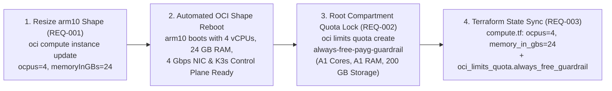

# Technical Design: Scale `arm10` to 4 OCPUs / 24 GB RAM & Lock Always-Free PAYG Quotas

**Feature ID**: `arm10-payg-scale-and-quota-lock`  
**Status**: Planning  

---

## 1. Architecture & Execution Flow (`REQ-001`, `REQ-002`, `REQ-003`)



---

## 2. In-Place `arm10` Shape Upgrade (`REQ-001`)

Target Instance OCID:
`ocid1.instance.oc1.ap-tokyo-1.anxhiljrnfuvvryc6oko53rm4ye7fjpo5xv7qybcbmm6p5pzjie66xtnqsna`

```bash
rtk oci compute instance update \
  --instance-id ocid1.instance.oc1.ap-tokyo-1.anxhiljrnfuvvryc6oko53rm4ye7fjpo5xv7qybcbmm6p5pzjie66xtnqsna \
  --shape-config '{"ocpus": 4, "memoryInGBs": 24}' \
  --force \
  --wait-for-state RUNNING
```

Post-reboot verification on `arm10`:
```bash
rtk ssh arm10 "lscpu | grep '^CPU(s):' && free -h && sudo /usr/local/bin/k3s kubectl get nodes -o wide"
```

---

## 3. Root Tenancy Compartment Quota Lock (`REQ-002`)

After `arm10` is running at `4 OCPUs / 24 GB RAM`, query `oci limits resource-availability get` for `standard-a1-core-count` and `standard-a1-memory-count` to inspect the exact `used` value recorded by OCI's quota accounting (e.g., `3` OCPUs / `18` GB if the initial `1 OCPU / 6 GB` remains in the base Free Tier bucket, or `4` OCPUs / `24` GB), and create the root Compartment Quota policy `always-free-payg-guardrail`:

```bash
rtk oci limits quota create \
  --compartment-id ocid1.tenancy.oc1..aaaaaaaagquicpnspzg47upmylb7zsjibo5oixmtddcxalh6hagvuvaj26jq \
  --name "always-free-payg-guardrail" \
  --description "Hard lock on Compute A1 and Block Storage to prevent usage beyond OCI Always Free PAYG tier ($0/mo)" \
  --statements '[
    "set compute-core quota standard-a1-core-count to <EXACT_USED_A1_CORES> in tenancy",
    "set compute-memory quota standard-a1-memory-count to <EXACT_USED_A1_MEMORY_GB> in tenancy",
    "set block-storage quota total-storage-gb to 200 in tenancy"
  ]' \
  --wait-for-state ACTIVE
```

Verification via `oci limits resource-availability get`:
- `standard-a1-core-count`: `available = 0`, `effective-quota-value = <EXACT_USED_A1_CORES>`
- `standard-a1-memory-count`: `available = 0`, `effective-quota-value = <EXACT_USED_A1_MEMORY_GB>`
- `total-storage-gb`: `effective-quota-value = 200` (`used = 194`, `available = 6`)

---

## 4. Declarative Terraform Codification (`REQ-003`)

In [`compute.tf`](file:///Users/thanghoang/github/oci/compute.tf#L117-L145):
1. Update `oci_core_instance.arm10.shape_config`:
   ```hcl
   shape_config {
     ocpus         = 4
     memory_in_gbs = 24
   }
   ```
2. Add `oci_limits_quota.always_free_guardrail`:
   ```hcl
   resource "oci_limits_quota" "always_free_guardrail" {
     compartment_id = var.tenancy_ocid
     name           = "always-free-payg-guardrail"
     description    = "Hard lock on Compute A1 and Block Storage to prevent usage beyond OCI Always Free PAYG tier ($0/mo)"
     statements = [
       "set compute-core quota standard-a1-core-count to <EXACT_USED_A1_CORES> in tenancy",
       "set compute-memory quota standard-a1-memory-count to <EXACT_USED_A1_MEMORY_GB> in tenancy",
       "set block-storage quota total-storage-gb to 200 in tenancy",
     ]
   }
   ```
3. Import `oci_limits_quota.always_free_guardrail` into `terraform.tfstate` and validate with `rtk terraform validate`.

---

## 5. Architecture Governance (`REQ-004`)
- Author [`docs/adr/0046-scale-arm10-4ocpu-24gb-and-lock-payg-quotas.md`](file:///Users/thanghoang/github/oci/docs/adr/0046-scale-arm10-4ocpu-24gb-and-lock-payg-quotas.md).
- Update [`docs/README.md`](file:///Users/thanghoang/github/oci/docs/README.md) to register `ADR-0046` and update the `arm10` hardware invariant from `12 GB RAM` to `4 OCPUs / 24 GB RAM`.
