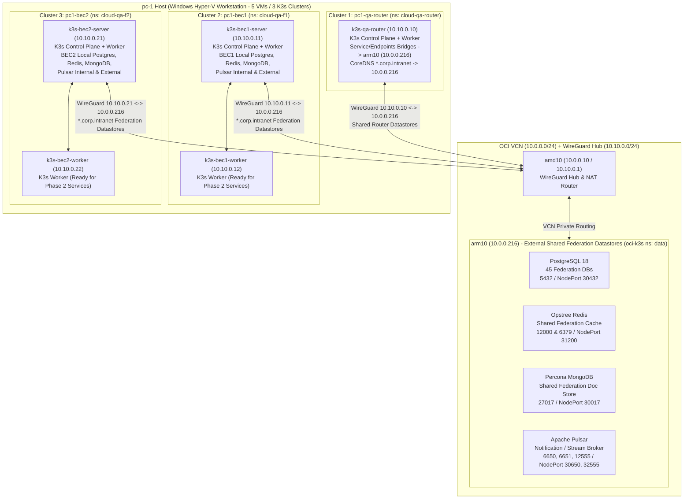

# Architecture Design: `pc-1` Multi-Cluster K3s Refactor & Hybrid Federation Datastores

- **Feature ID**: `pc1-qa-router-multicluster-refactor`
- **Status**: `Planning`
- **Date**: 2026-10-31
- **Addresses**: `REQ-001`, `REQ-002`, `REQ-003`, `REQ-004`, `REQ-005`, `REQ-006`

---

## 1. Target Multi-Cluster & Datastore Topology

Addresses: `REQ-001`, `REQ-002`, `REQ-003`, `REQ-004`, `REQ-005`, `REQ-006`

---

## 2. Component Design by Requirement

### 2.1 Legacy `pc-1` Teardown & `arm10` Node Cleanup (`Addresses: REQ-001`)
1. Remove `k3s-worker-1..4` from `arm10` (`oci-k3s`) and clean stale WireGuard peers (`10.10.0.2..5`) on `amd10`.
2. Stop and delete `k3s-worker-1..4` Hyper-V VMs and virtual disks on `pc-1`.

### 2.2 Hyper-V VM Sizing & WireGuard Mesh Provisioning (`Addresses: REQ-002`)
1. Inspect `pc-1` physical RAM and CPU via PowerShell and allocate ~80% of host RAM across the 5 Generation 2 VMs:
   - `k3s-qa-router` (`10.10.0.10`): ~16% of VM RAM budget, 4 vCPUs, 60 GB dynamic VHDX.
   - `k3s-bec1-server` (`10.10.0.11`): ~21% of VM RAM budget, 4 vCPUs, 80 GB dynamic VHDX.
   - `k3s-bec1-worker` (`10.10.0.12`): ~21% of VM RAM budget, 4 vCPUs, 60 GB dynamic VHDX.
   - `k3s-bec2-server` (`10.10.0.21`): ~21% of VM RAM budget, 4 vCPUs, 80 GB dynamic VHDX.
   - `k3s-bec2-worker` (`10.10.0.22`): ~21% of VM RAM budget, 4 vCPUs, 60 GB dynamic VHDX.
2. Configure WireGuard (`wg0`) on all 5 VMs peering with `amd10` (`10.10.0.1`) with `AllowedIPs = 10.10.0.0/24, 10.0.0.0/24` and `PersistentKeepalive = 25`.

### 2.3 K3s Multi-Cluster Bootstrap & Kubeconfig Registration (`Addresses: REQ-003`)
1. **`pc1-qa-router`**: Install K3s server on `k3s-qa-router` (`10.10.0.10`, `--cluster-cidr=10.42.0.0/16 --service-cidr=10.43.0.0/16 --disable=traefik --kubelet-arg=max-pods=250`) and create namespace `cloud-qa-router`.
2. **`pc1-bec1`**: Install K3s server on `k3s-bec1-server` (`10.10.0.11`, `--cluster-cidr=10.142.0.0/16 --service-cidr=10.143.0.0/16 --disable=traefik --kubelet-arg=max-pods=250`), join `k3s-bec1-worker` (`10.10.0.12`), and create namespace `cloud-qa-f1`.
3. **`pc1-bec2`**: Install K3s server on `k3s-bec2-server` (`10.10.0.21`, `--cluster-cidr=10.242.0.0/16 --service-cidr=10.243.0.0/16 --disable=traefik --kubelet-arg=max-pods=250`), join `k3s-bec2-worker` (`10.10.0.22`), and create namespace `cloud-qa-f2`.
4. Merge kubeconfig contexts `pc1-qa-router`, `pc1-bec1`, and `pc1-bec2` into `/Users/thanghoang/.kube/config`.

### 2.4 `arm10` External Shared Federation Datastores & Cross-Cluster DNS (`Addresses: REQ-004`)
1. Update `charts/vinhthang-fleet/` on `arm10` (`10.0.0.216`) so PostgreSQL 18, Opstree Redis (1 replica on `arm10`), Percona MongoDB (1 replica on `arm10`), and Apache Pulsar run in namespace `data` on `arm10` and expose VCN/WireGuard ports (`5432`, `12000`/`6379`, `27017`, `6650`/`6651`/`12555`) without binding host port `8080`.
2. Seed all 45 `POSTGRES_MULTIPLE_DATABASES` schemas on `arm10` PostgreSQL.
3. Configure `coredns-custom` ConfigMaps in `kube-system` across `pc1-qa-router`, `pc1-bec1`, and `pc1-bec2` mapping `qa-fed-router-pg.corp.intranet`, `router-rds-lb-qa-fed.corp.intranet`, `router-mongo-lb-qa-fed.corp.intranet`, `pulsar-stream-qa-fed.corp.intranet`, and `pulsar-admin-qa-fed.corp.intranet` to `10.0.0.216`.
4. Create Kubernetes `Service` + `Endpoints` bridges in `cloud-qa-router` (`pc1-qa-router`) for `vedge-api-postgres-service`, `redb-cloud-qa-router-headless`, `mck-mongodb-cloud-qa-router-mongos-lb`, and `pulsar-noti-cloud-qa-router-broker` pointing to `10.0.0.216`.

### 2.5 Compact 1-Replica Local BEC Datastores in `pc1-bec1` and `pc1-bec2` (`Addresses: REQ-005`)
1. Deploy declarative StatefulSets/Deployments and Services in `cloud-qa-f1` (`pc1-bec1`) and `cloud-qa-f2` (`pc1-bec2`):
   - `vedge-api-postgres-service:5432` (`postgres:16.8-alpine`) with init script creating the 10 BEC-local databases.
   - `redb-cloud-qa-f1-headless:12000` / `redb-cloud-qa-f2-headless:12000` (`redis:7.4.2-alpine` on port `12000`).
   - `mck-mongodb-cloud-qa-f1-mongos-lb:27017` / `mck-mongodb-cloud-qa-f2-mongos-lb:27017` (`mongo:7.0.16` on port `27017`).
   - `pulsar-internal-cloud-qa-f*-broker` and `pulsar-external-cloud-qa-f*-broker` (`apachepulsar/pulsar:3.0.7` standalone brokers exposing `6650`, `6651`, `8080`, `8443` inside cluster Service DNS).
   - Seed deterministic K8s Secrets (`postgres-secret`, `redis-secret`, `mongodb-secret`, self-signed Pulsar TLS certs) in `cloud-qa-router`, `cloud-qa-f1`, and `cloud-qa-f2`.

### 2.6 ADR-0047 & Documentation Governance (`Addresses: REQ-006`)
1. Create `/Users/thanghoang/github/oci/docs/adr/0047-pc1-multi-cluster-qa-router-federation-topology.md` and register in `/Users/thanghoang/github/oci/docs/README.md`.
