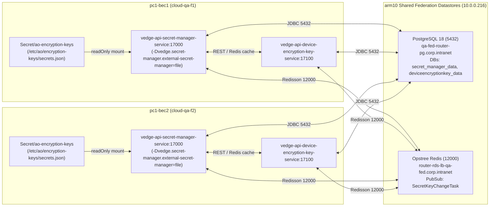

# Architecture Design: End-to-End Verification of `kube_vedge!2597` (`ANO-16455`) on `pc-1`

- **Feature ID**: `pc1-secret-manager-1password-test`
- **Status**: `In-Progress`
- **Date**: 2026-11-02
- **Addresses**: `REQ-001`, `REQ-002`, `REQ-003`, `REQ-004`

---

## 1. End-to-End Architecture & Data Flow



---

## 2. Component Design Mapped to Requirements

### 2.1 Offline Helm Template Validation of `kube_vedge!2597` (`REQ-001`)
On `pc-1` (`C:\Users\thang\gitlab\kube_vedge`), fetch `origin/codex/ano-16455-oci-qa-fed-encryption` (`commit 69a69619`) and execute `helm template` against:
1. `vedge-mv/vedge-api` with `-f vedge-mv/vedge-api/oci-cloud-qa2-values.yaml`
2. `vedge-mv-unify-singleapp/placeholder` with `-f vedge-mv-unify-singleapp/placeholder/oci-cloud-qa-f1-values.yaml`
3. `vedge-mv-unify-singleapp/placeholder` with `-f vedge-mv-unify-singleapp/placeholder/oci-cloud-qa-f2-values.yaml`
4. `vedge-mv-unify-singleapp/placeholder/external-secrets-seed` with `-f oci-cloud-qa-f1-extsec.yaml` and `-f oci-cloud-qa-f2-extsec.yaml`

### 2.2 Container Image Build & K3s Node Import (`REQ-002`)
On `pc-1` (`C:\Users\thang\gitlab\vedge_api`):
1. Build `vedge-api-secret-manager-service` and `vedge-api-device-encryption-key-service` JARs via Maven (`mvn package -DskipTests -pl vedge-api-secret-manager-service,vedge-api-device-encryption-key-service -am`).
2. Build Docker images `vedge-api-secret-manager-service:ANO-17479` and `vedge-api-device-encryption-key-service:ANO-17479`.
3. Save images to a tarball and import into `k3s ctr --namespace k8s.io images import` on `k3s-bec1-server` (`192.168.1.242`), `k3s-bec1-worker` (`192.168.1.243`), `k3s-bec2-server` (`192.168.1.244`), and `k3s-bec2-worker` (`192.168.1.245`).

### 2.3 Declarative `charts/vedge-api-local/` Enhancements (`REQ-003`)
Create `/Users/thanghoang/github/oci/charts/vedge-api-local/`:
- `templates/secret.yaml`: Renders `Secret/ao-encryption-keys` containing `secrets.json`:
  ```json
  {
    "ao-encryption-key": {
      "1": "MDEyMzQ1Njc4OWFiY2RlZjAxMjM0NTY3ODlhYmNkZWY="
    }
  }
  ```
- `templates/deployment.yaml`:
  - Supports per-service `redisHosts`: `{{ $svc.redisHosts | default $.Values.global.databases.redis.hosts }}`
  - Supports per-service `volumeMounts` on the container spec and `volumes` on the pod spec.
- `values-bec1.yaml` & `values-bec2.yaml`:
  - Preserves all 13 existing service definitions from `vedge-api-bec1` and `vedge-api-bec2` unchanged.
  - Adds `vedge-api-secret-manager-service` (`enabled: true`, `port: 17000`, `postgresEnabled: true`, `postgresHost: qa-fed-router-pg.corp.intranet`, `dbName: secret_manager_data`, `redisEnabled: true`, `redisHosts: router-rds-lb-qa-fed.corp.intranet:12000`, `extraJvmArgs: "-Dvedge.secret-manager.external-secret-manager=file -Dvedge.secret-manager.secret-file-path=/etc/ao/encryption-keys/secrets.json"`, `volumeMounts` + `volumes` mounting `ao-encryption-keys` at `/etc/ao/encryption-keys` read-only).
  - Adds `vedge-api-device-encryption-key-service` (`enabled: true`, `port: 17100`, `postgresEnabled: true`, `postgresHost: qa-fed-router-pg.corp.intranet`, `dbName: deviceencryptionkey_data`, `redisEnabled: true`, `redisHosts: router-rds-lb-qa-fed.corp.intranet:12000`).

### 2.4 Runtime & Cross-BEC Synchronization Verification (`REQ-004`)
1. Inspect pod logs of `vedge-api-secret-manager-service` in `cloud-qa-f1` and `cloud-qa-f2` for `Loaded [1] secrets from file [/etc/ao/encryption-keys/secrets.json].`
2. Inspect `arm10` PostgreSQL `secret_manager_data` tables (`encryption_key_metadata`) and `deviceencryptionkey_data` tables (`device_encryption_key`).
3. Call `POST http://vedge-api-secret-manager-service:17000/secret-manager` with `{"name":"ao-encryption-key","version":"1"}` in `cloud-qa-f1` (`pc1-bec1`).
4. Verify `GET http://vedge-api-secret-manager-service:17000/secret-manager/name/ao-encryption-key` and `GET http://vedge-api-secret-manager-service:17000/secret-manager/all` in `cloud-qa-f2` (`pc1-bec2`) return the synchronized key (`name="ao-encryption-key"`, `version="1"`, `currentVersion=true`, `secret="MDEyMzQ1Njc4OWFiY2RlZjAxMjM0NTY3ODlhYmNkZWY="`).
