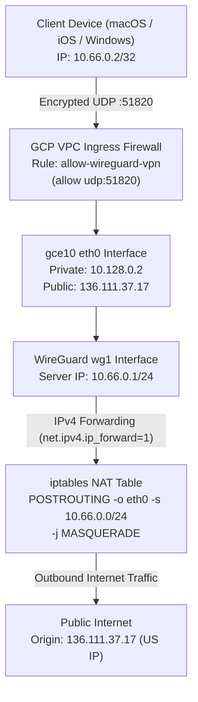

# Technical Design: WireGuard US VPN Server on GCP Host (`gce10`)

**Feature ID**: `wireguard-us-vpn`  
**Status**: Proposed  

---

## 1. System Architecture & Packet Flow



---

## 2. Server Configuration (`/etc/wireguard/wg1.conf`)

```ini
[Interface]
Address = 10.66.0.1/24
ListenPort = 51820
PrivateKey = <SERVER_PRIVATE_KEY>

# Firewall & NAT Masquerading Rules
PostUp = iptables -A INPUT -p udp --dport 51820 -j ACCEPT; iptables -A FORWARD -i wg1 -j ACCEPT; iptables -A FORWARD -o wg1 -m state --state RELATED,ESTABLISHED -j ACCEPT; iptables -t nat -A POSTROUTING -o eth0 -s 10.66.0.0/24 -j MASQUERADE
PostDown = iptables -D INPUT -p udp --dport 51820 -j ACCEPT; iptables -D FORWARD -i wg1 -j ACCEPT; iptables -D FORWARD -o wg1 -m state --state RELATED,ESTABLISHED -j ACCEPT; iptables -t nat -D POSTROUTING -o eth0 -s 10.66.0.0/24 -j MASQUERADE

[Peer]
# Client 1: User Device
PublicKey = <CLIENT_PUBLIC_KEY>
AllowedIPs = 10.66.0.2/32
```

---

## 3. Client Configuration (`wg1-client.conf`)

```ini
[Interface]
PrivateKey = <CLIENT_PRIVATE_KEY>
Address = 10.66.0.2/32
DNS = 1.1.1.1, 8.8.8.8

[Peer]
PublicKey = <SERVER_PUBLIC_KEY>
Endpoint = 136.111.37.17:51820
AllowedIPs = 0.0.0.0/0, ::/0
PersistentKeepalive = 25
```

---

## 4. Google Cloud Firewall Declaration

```bash
gcloud compute firewall-rules create allow-wireguard-vpn \
    --project vietcalendar \
    --account thanghv@gmail.com \
    --network default \
    --priority 1000 \
    --direction INGRESS \
    --action ALLOW \
    --rules udp:51820 \
    --source-ranges 0.0.0.0/0 \
    --target-tags http-server \
    --description "Allow inbound WireGuard VPN road-warrior traffic on port 51820"
```

---

## 5. Security Invariants & Isolation
1. **Restrictive File Permissions**: `/etc/wireguard/wg1.conf` and all private keys must be owned by `root:root` with permissions `0600`.
2. **Subnet Isolation**: No routes for `10.42.0.0/16` (Pod CIDR) or `10.0.0.0/16` (OCI VCN) are broadcasted into the client configuration. The client routes full-tunnel `0.0.0.0/0` directly out through `eth0` NAT masquerade to ensure privacy and prevent internal cluster routing loops.
3. **Multi-Tunnel Coexistence**: Interface `wg0` (Tokyo mesh `10.10.0.4/24`) and `wg1` (US VPN `10.66.0.1/24`) operate completely independently in the Linux kernel on distinct ports.
